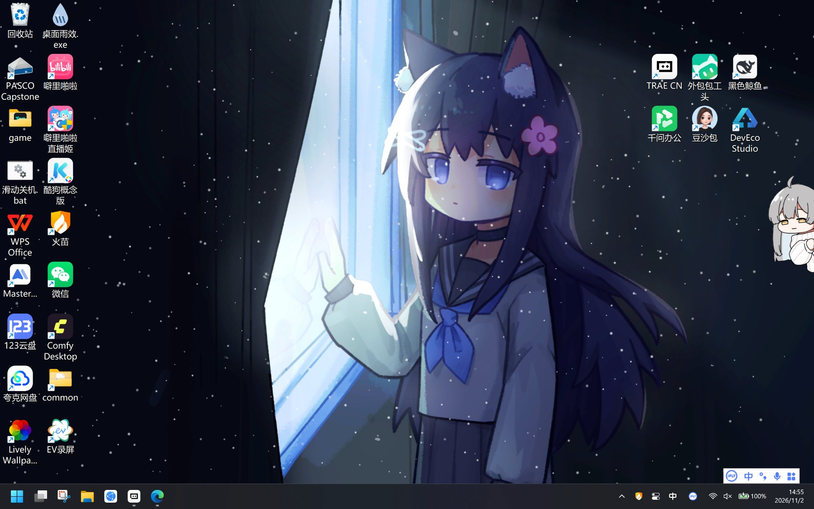
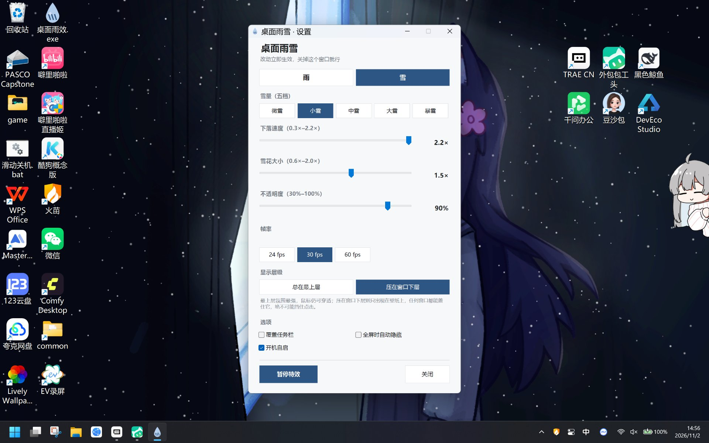

# Snowy Desktop · 桌面雨雪特效



给 Windows 桌面加一层雨或雪。全屏铺满、不挡鼠标，看视频打游戏时会自动让路。

## 下载

到 [Releases](https://github.com/HM-U3/snowy-desktop/releases/latest) 下载 `SnowyDesktop-v1.0.0-win-x64.exe`，双击就能用。免安装，不写注册表。

需要先装 [.NET 8 Desktop Runtime](https://dotnet.microsoft.com/download/dotnet/8.0)（x64，要选 “.NET Desktop Runtime”，不是普通的 .NET Runtime）。

## 使用

启动后没有主窗口，常驻托盘：

| 操作 | 效果 |
| --- | --- |
| 左键单击托盘图标 | 打开设置 |
| 再次双击 exe | 同上（不会开第二个实例） |
| 右键托盘图标 | 设置 / 暂停 / 退出 |



## 设置

雨和雪是两个独立页面，两边参数互不影响：

| 页面 | 可调 |
| --- | --- |
| 雨 | 雨量五档、下落速度、不透明度、雨丝长度 |
| 雪 | 雪量五档、下落速度、雪花大小、不透明度 |
| 通用 | 24 / 30 / 60 fps、显示层级、覆盖任务栏、全屏自动隐藏、开机自启 |

拖动滑杆立即生效，没有「确定」按钮；关掉窗口设置也保留。

**显示层级**有两个选项：

- **压在窗口下层**（默认）：只在壁纸上显示，任何窗口都能盖住它，绝不影响点击
- **总在最上层**：特效会显示在窗口之上，鼠标依然能穿透，不影响任何操作

## 文件位置

| 内容 | 路径 |
| --- | --- |
| 程序 | 你自己放的位置（示例：`%USERPROFILE%\Desktop\` 下） |
| 配置 | `%APPDATA%\DesktopRain\config.json` |
| 运行日志 | `%APPDATA%\DesktopRain\rain.log` |

**卸载**：托盘菜单退出，删掉 exe 和 `%APPDATA%\DesktopRain\` 即可。

## 从源码构建

```
dotnet publish -c Release -r win-x64 --self-contained false -p:PublishSingleFile=true -o dist
```

## 许可

MIT，见 [LICENSE](LICENSE)。雨效的物理参数来自 Steam 创意工坊 VPet 天气播报 mod（`1920960 / 3818935600`）。
